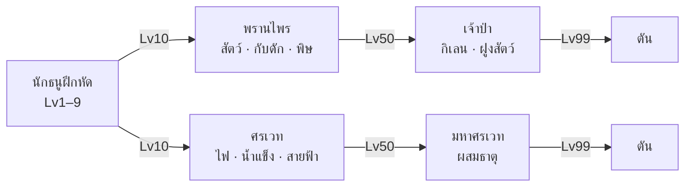

# ต้นสกิลนักธนู — PRAN: Hunter of Himmapan

สถานะ: **ร่าง รอเจ้าของอนุมัติ** (2026-11-06)
ขอบเขต: วางต้นสกิลครบถึง Lv99 แต่ลงรายละเอียดตัวเลข เอฟเฟกต์ และไอคอนเฉพาะสกิลเฟส 1 (Lv1–10)
ข้อที่ติด **[ผมเลือกเอง]** คือจุดที่เจ้าของยังไม่ได้กำหนด แก้ได้

## กติการวม
- สกิลมี 2 ชนิด: **กดใช้** (ใส่ปุ่มสกิลได้ 4 ช่อง) และ **ติดตัว** (ทำงานเองตลอด ไม่ใช้ช่อง) ส่วนยิงปกติกับกลิ้งหลบมีปุ่มของตัวเอง
- **เลเวลสกิลขึ้นเองทุก 1 เลเวลตัวละคร**: ดาเมจ +5% ต่อเลเวลสกิล และคูลดาวน์ −1% ต่อเลเวลสกิล (ลดได้สูงสุด −30%)
- สกิลอาชีพปลดทุก 10 เลเวล (สกิลกดใช้) โดยมีสกิลติดตัวแทรกที่เลเวลลงท้าย 5
- ใส่รูนได้ 1 อันต่อสกิลกดใช้ (ดู spec-numbers §9)
- ไอคอนสกิลขนาด 32×32 วาดด้วย PixelLab มีกรอบเปลี่ยนตามเลเวลสกิล ไม้ → สำริด (10) → เงิน (25) → ทอง (50) → ทองประกาย (75)
- เอฟเฟกต์เป็น pixel art ทำด้วย vfx_workbench ของ PixelLab (ใช้ฟรี) แทรกลายไทย เช่น ลายกนก ยันต์ ดอกพิกุล

---

## 1. นักธนูฝึกหัด (Lv1–9) — รายละเอียดเฟส 1
| ปลด | สกิล | ชนิด | ผล (เลเวลสกิล 1) | CD | เอฟเฟกต์ |
|---|---|---|---|---|---|
| — | ยิงปกติ | ปุ่มโจมตี | 100% ระยะ 220px | 0.8 วิ | ลูกศรไม้ ปลายมีแสงเล็ก ๆ |
| 1 | **ศรทะลวง** | กดใช้ | 180% ทะลุทุกตัวในแนว | 4 วิ | ลูกศรยาวมีหางแสงขาวทอง ทิ้งเส้นลายกนกจาง ๆ |
| 1 | **สายตาพราน** [ผมเลือกเอง] | ติดตัว | ยิงโดนเป้าที่ไกลเกิน 150px ดาเมจ +10% | — | ตัวเลขดาเมจเป็นสีทอง |
| 3 | **ศรกระจาย** | กดใช้ | 5 ดอกเป็นรูปพัด 45° ดอกละ 70% | 6 วิ | ลูกศร 5 ดอกแตกจากวงดอกพิกุลหน้าคันธนู |
| 5 | **กลิ้งหลบ** | ปุ่มของตัวเอง | พุ่ง 96px อมตะ 0.3 วิ | 3 วิ | ฝุ่นใบไม้กับเงาจาง ๆ |
| 5 | **ฝีเท้าพราน** [ผมเลือกเอง] | ติดตัว | เดินเร็วขึ้น +5% และหลังกลิ้งหลบเดินเร็วขึ้น +20% นาน 1.5 วิ | — | รอยเท้าเรืองแสงสั้น ๆ |
| 7 | **ห่าศร** | กดใช้ | วงรัศมี 64px นาน 3 วิ ทิกละ 40% ทุก 0.5 วิ (รวม 240%) | 10 วิ | ยันต์วงกลมบนพื้น ลูกศรตกจากฟ้า |

## 2. อาชีพพื้นฐาน (Lv10–49)
### พรานไพร — สัตว์ กับดัก พิษ
| ปลด | สกิล | ชนิด | ผล | CD |
|---|---|---|---|---|
| **10** | **กับดักหนาม** (เฟส 1) | กดใช้ | วางกับดักไกลสุด 160px ตรึง 2 วิ + 150% วางค้างได้ 2 อัน | 8 วิ |
| 15 | สัญชาตญาณพราน | ติดตัว | ดาเมจ +15% ใส่เป้าที่ติดกับดักหรือติดพิษ | — |
| 20 | ยิงพิษ | กดใช้ | 120% + พิษ 30%/วิ นาน 5 วิ | 6 วิ |
| 25 | พิษซ้อน | ติดตัว | พิษซ้อนได้ 3 ชั้น | — |
| 30 | เรียกหมาไน | กดใช้ | หมาไนคู่ใจ 20 วิ กัดวิละ 60% ATK | 30 วิ |
| 35 | ผูกพันสัตว์ | ติดตัว | สัตว์คู่ใจแรงขึ้น +30% อยู่นานขึ้น +5 วิ | — |
| 40 | เหยี่ยวล่าเหยื่อ | กดใช้ | เหยี่ยวมาร์กเป้า 6 วิ เป้าโดนแรงขึ้น +20% และเหยี่ยวจิก 3 ครั้ง ครั้งละ 50% | 15 วิ |

### ศรเวท — ไฟ น้ำแข็ง สายฟ้า
| ปลด | สกิล | ชนิด | ผล | CD |
|---|---|---|---|---|
| **10** | **ศรเพลิง** (เฟส 1) | กดใช้ | 200% + ไหม้ 20%/วิ นาน 3 วิ ระเบิดวงเล็ก r32 ตอนโดน | 6 วิ |
| 15 | ใจธาตุ | ติดตัว | ดาเมจธาตุ +10% | — |
| 20 | ศรน้ำแข็ง | กดใช้ | 160% + ช้าลง 40% นาน 3 วิ | 7 วิ |
| 25 | เยือกแข็ง | ติดตัว | เป้าที่ช้าอยู่ โดนครั้งที่ 3 จะแข็ง 1 วิ (แต่ละเป้าเกิดได้ทุก 5 วิ) | — |
| 30 | ศรอสนี | กดใช้ | 220% สายฟ้ากระโดด 4 เป้า ลดลงทีละ 20% | 9 วิ |
| 35 | ประจุสายฟ้า | ติดตัว | สายฟ้ากระโดดเพิ่ม +1 เป้า | — |
| 40 | ยันต์ธาตุ | กดใช้ | 8 วิ ยิงปกติติดธาตุล่าสุดที่ใช้ และยิงเร็วขึ้น +30% | 20 วิ |

## 3. อาชีพขั้น 2 (Lv50–99) — วางโครงไว้ก่อน ตัวเลขทำในเฟสนั้น
### เจ้าป่า (ต่อจากพรานไพร)
| ปลด | สกิล | ชนิด | ผล |
|---|---|---|---|
| 50 | ปลุกกิเลน | กดใช้ | เรียกกิเลน 25 วิ พ่นไฟเป็นรูปกรวย |
| 55 | ป่าคุ้มภัย | ติดตัว | ขณะมีสัตว์คู่ใจ DEF +20% |
| 60 | บ่วงบาศพราน | กดใช้ | ดึงศัตรูรอบ ๆ เข้ากลางแล้วตรึง |
| 65 | เจ้าแห่งฝูง | ติดตัว | มีสัตว์คู่ใจพร้อมกันได้ 2 ตัว |
| 70 | ฝนพิษ | กดใช้ | พิษตกเป็นวงกว้าง |
| 75 | เขี้ยวพิษ | ติดตัว | สัตว์คู่ใจทำให้ติดพิษ |
| 80 | ขี่กิเลน | กดใช้ | ขี่กิเลน 8 วิ เดินเร็ว +50% ไม่โดนควบคุม ยิงเป็นศรไฟ |
| 85 | ใจป่า | ติดตัว | ไม่โดนตี 3 วิแล้วฟื้นเลือด 2%/วิ |
| 90 | พิโรธหิมพานต์ | กดใช้ | ฝูงสัตว์หิมพานต์วิ่งข้ามจอ |
| 99 | เจ้าแห่งพงไพร | ติดตัว (ตัน) | สกิลสัตว์คู่ใจทุกตัว CD −20% |

### มหาศรเวท (ต่อจากศรเวท)
| ปลด | สกิล | ชนิด | ผล |
|---|---|---|---|
| 50 | พายุเพลิงอสนี | กดใช้ | ไฟผสมสายฟ้า เป็นพายุวงกว้าง |
| 55 | ธาตุผสาน | ติดตัว | ใช้สกิลต่างธาตุภายใน 3 วิ เกิดระเบิดผสาน 150% |
| 60 | ศรธารน้ำแข็ง | กดใช้ | แนวน้ำแข็งยาว ทำให้แข็ง |
| 65 | ชำนาญธาตุ | ติดตัว | ลดค่าต้านธาตุของศัตรู 15% |
| 70 | ห่าอัคนี | กดใช้ | ลูกศรอุกกาบาตตกเป็นวง |
| 75 | เวทหมุนเวียน | ติดตัว | ฆ่าศัตรูแล้ว CD ทุกสกิลลด 0.5 วิ |
| 80 | ศรสุริยะ | กดใช้ | ลำแสงทะลุ ยิงค้าง 2 วิ |
| 85 | ปราการธาตุ | ติดตัว | ทุก 20 วิ ได้โล่ธาตุดูดดาเมจ 15% ของ HP สูงสุด |
| 90 | ศรมหาประลัย | กดใช้ | ระเบิดสามธาตุเต็มจอ |
| 99 | ผู้หยั่งรู้ธาตุ | ติดตัว (ตัน) | ดาเมจธาตุทั้งหมด +25% |

## 4. สัตว์คู่ใจ (ตามที่เจ้าของเลือก)
| สัตว์ | ได้ที่ | ขนาดภาพ | งบ PixelLab |
|---|---|---|---|
| หมาไน | พรานไพร Lv30 | 32×32 | ~20–30 gen |
| เหยี่ยว | พรานไพร Lv40 | 32×32 | ~20–30 gen |
| กิเลน | เจ้าป่า Lv50 / ขี่ได้ Lv80 | 64×64 | ~30–50 gen |
- ทั้ง 3 ตัวไม่อยู่ในเฟส 1 จึงยังไม่ต้องใช้ gen

## 5. งานภาพเฟส 1
| ของ | จำนวน | งบ PixelLab |
|---|---|---|
| ไอคอนสกิล (ยิงปกติ ศรทะลวง สายตาพราน ศรกระจาย กลิ้งหลบ ฝีเท้าพราน ห่าศร กับดักหนาม ศรเพลิง) | 9 | ~90 gen |
| กรอบไอคอน 5 ระดับ | 5 | 0 (วาดด้วยเครื่องมือฟรี) |
| เอฟเฟกต์สกิล (ลูกศร หางแสง วงยันต์ กับดัก ไฟ) | ~7 ชุด | 0 (vfx_workbench ฟรี) |
